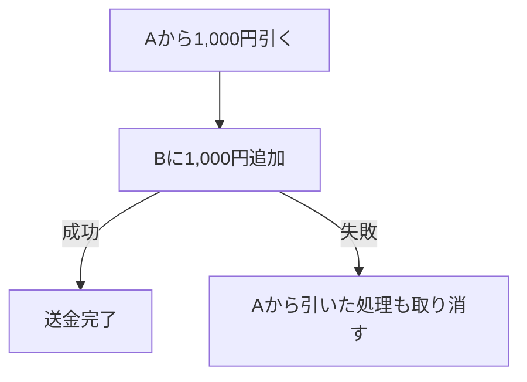
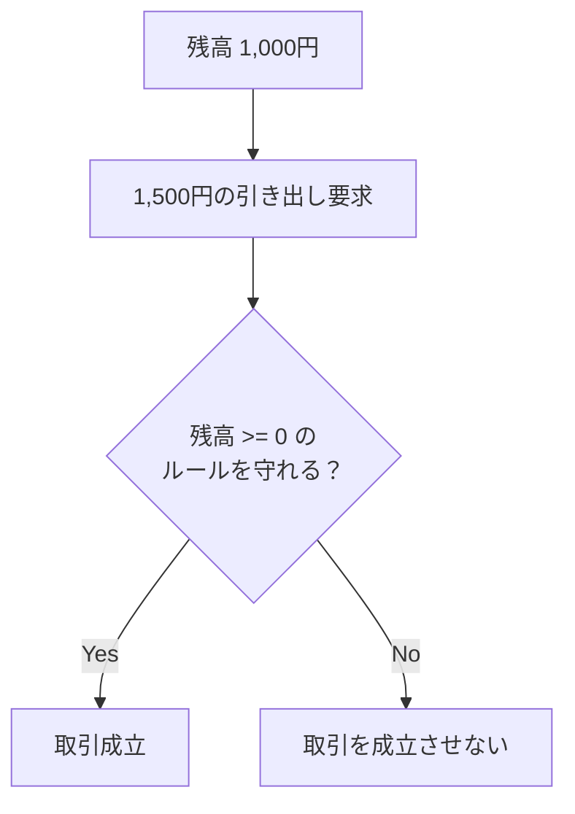
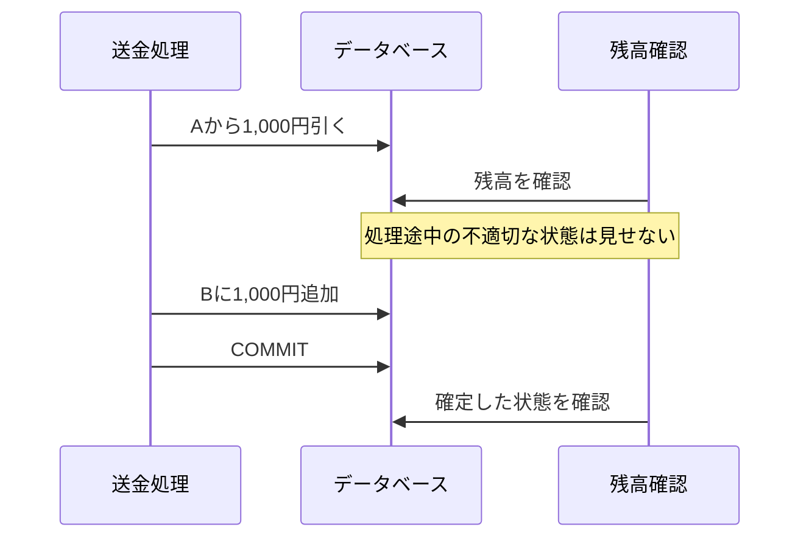
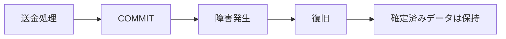
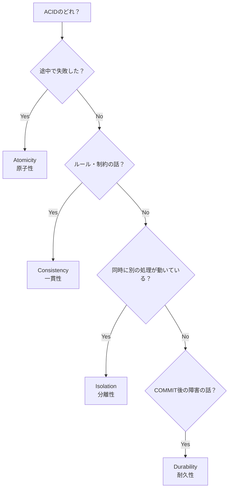

# ACID特性まとめ

## 結論

ACIDとは、データベースのトランザクションを安全・正確に処理するための4つの特性です。

| 特性 | 一言でいうと |
|---|---|
| **Atomicity（原子性）** | **全部成功するか、全部失敗するか** |
| **Consistency（一貫性）** | **決められたルールを破らない** |
| **Isolation（分離性）** | **処理途中の状態を他の処理から見せない** |
| **Durability（耐久性）** | **完了した結果は失われない** |

## 簡単な例：銀行口座

口座Aから口座Bへ1,000円送金するとします。

```text
送金前

口座A：10,000円
口座B： 5,000円

↓ 1,000円送金

送金後

口座A：9,000円
口座B：6,000円
```

この処理を安全に実行するためにACIDの4つの特性が関係します。

- **原子性**：Aから引いたのにBに入らなかった、を防ぐ
- **一貫性**：残高などに設定されたルールを破らない
- **分離性**：送金途中の中途半端な状態を他の処理から見せない
- **耐久性**：送金完了後に障害が発生しても結果を失わない

---

# 1. Atomicity（原子性）

## 結論

> **一連の処理は、全部成功するか、全部失敗する。**

「途中まで成功」という状態で確定させない性質です。

## 例

口座Aから口座Bへ1,000円送金します。

```text
① 口座Aから1,000円引く
        ↓
② 口座Bに1,000円追加する
```

しかし、②でエラーが発生したとします。

```text
① Aから1,000円引く → 成功
② Bに1,000円追加   → 失敗
```

このままでは1,000円が消えてしまいます。

そこで、①も取り消します。



つまり、

> **All or Nothing（全部かゼロか）**

が原子性です。

### 試験でのキーワード

- 全部成功 or 全部失敗
- 処理途中で失敗
- ロールバック
- 一部だけ確定させない

---

# 2. Consistency（一貫性）

## 結論

> **トランザクションの前後で、データベースに設定されたルールや制約を守る。**

「データベースを不正な状態にしない」という考え方です。

## 例：残高をマイナスにしてはいけない

次のルールがあるとします。

> **口座残高は0円未満にしてはいけない**

現在の残高が1,000円なのに、1,500円を引き出そうとします。

```text
現在

口座A：1,000円

↓ 1,500円引き出そうとする

1,000 - 1,500 = -500円

↓    

「残高は0円以上」というルールに違反
```

この取引を成立させてしまうと、

```text
口座A：-500円
```

となり、データベースのルールに違反します。

そのため、不正な状態にならないようにします。



### 他の例

一貫性は金額だけではありません。

たとえば、

```text
・主キーは重複してはいけない
・NOT NULLの列をNULLにしてはいけない
・存在しない顧客IDを注文データに登録してはいけない
・残高を0円未満にしてはいけない
```

など、データベースで定めた制約やルールを守ることに関係します。

### 試験でのキーワード

- ルール
- 制約
- 有効な状態
- 不正なデータにしない
- データの整合性

---

# 3. Isolation（分離性）

## 結論

> **あるトランザクションの処理途中の状態が、別のトランザクションに不適切な形で影響しないようにする。**

特に試験では、

> **同時に動いている別の処理**

が出てきたらIsolationを疑います。

## 例

口座Aから口座Bへ1,000円送金している途中だとします。

```text
① A：10,000円 → 9,000円
② B： 5,000円 → 6,000円
```

①だけ終わった瞬間に、別の処理が残高を確認すると、

```text
A：9,000円  ← 更新済み
B：5,000円  ← まだ更新されていない
```

という中途半端な状態が見えてしまう可能性があります。

Isolationは、このような**他のトランザクションとの干渉を制御するための性質**です。



### 試験でのキーワード

- 同時実行
- 別のトランザクション
- 他のユーザー・処理から見えるか
- 処理途中
- トランザクション同士の干渉

---

# 4. Durability（耐久性）

## 結論

> **一度正常にコミットされたデータは、その後に障害が発生しても保持される。**

## 例

送金が正常に完了しました。

```text
口座A：9,000円
口座B：6,000円

COMMIT
```

直後にサーバー障害が発生したとしても、

```text
障害発生
   ↓
サーバー復旧
   ↓
口座A：9,000円
口座B：6,000円
```

というように、**確定済みの結果が失われない**ことが耐久性です。



### 試験でのキーワード

- COMMIT後
- データを保持
- 障害
- 再起動
- 確定済みデータが失われない

---

# AtomicityとIsolationの違い

特に間違えやすいのがこの2つです。

## Atomicity

> **そのトランザクション自体が途中で失敗したらどうするか**

```text
Aから引く → 成功
Bに足す   → 失敗

↓ Atomicity

Aから引いた処理も取り消す
```

## Isolation

> **そのトランザクションの途中に、別のトランザクションが動いたらどうするか**

```text
送金処理
├─ Aから引く
│
│ ← このタイミングで別の処理が残高確認
│
└─ Bに足す
```

このように、**他のトランザクションとの関係**を扱うのがIsolationです。

---

# 試験での見分け方



## 最後に一言で覚える

```text
A：Atomicity
   → 全部かゼロか

C：Consistency
   → ルールを守る

I：Isolation
   → 他の処理と干渉しない

D：Durability
   → 確定したら残る
```

### 銀行の例なら

```text
原子性
→ 送金は全部成功か全部取り消し

一貫性
→ 残高などのルールを破らない

分離性
→ 送金途中を他の処理に不適切な形で見せない

耐久性
→ 送金完了後に障害が起きても結果が残る
```
