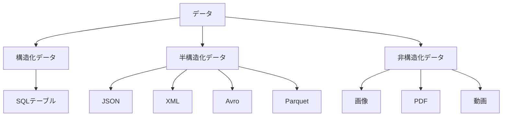
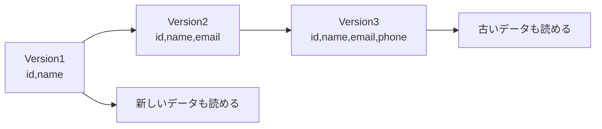
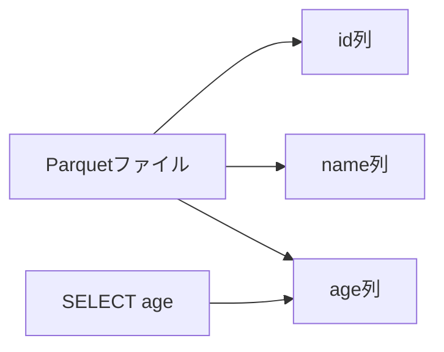
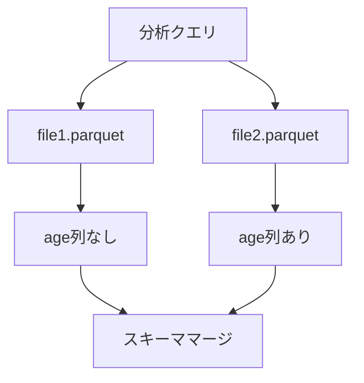
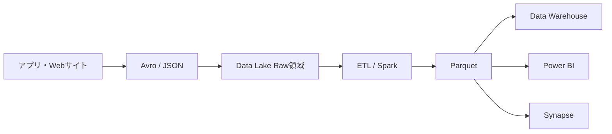

# Avro と Parquet の違いまとめ

## 結論

- **Avro は「データの受け渡し・蓄積向け」**
  - スキーマ変更（列追加など）に強い
  - イベントログやストリーミングデータに向く

- **Parquet は「分析向け」**
  - 集計や検索が高速
  - データウェアハウスや BI 分析に向く

実務では、

```text
生データ
↓
Avro / JSON
↓
加工・整形
↓
Parquet
↓
分析・レポート
```

という流れがよく採用される。

---

# なぜ Avro は半構造化データなのか

半構造化データとは、

> 構造（スキーマ）は持っているが、厳密なテーブル構造に固定されていないデータ

のこと。

## データ分類



---

# JSON と Avro の違い

JSON はデータの中にフィールド名が毎回含まれる。

```json
{
  "id": 1,
  "name": "Tanaka",
  "age": 30
}
```

100万件あれば、

```text
"id"
"name"
"age"
```

が100万回保存される。

---

Avro はスキーマを別に持つ。

## スキーマ

```json
{
  "fields": [
    {"name":"id","type":"int"},
    {"name":"name","type":"string"},
    {"name":"age","type":"int"}
  ]
}
```

## データ

```text
1,Tanaka,30
2,Suzuki,25
```

データ本体にはフィールド名を毎回保存しないため、

- 容量が小さい
- 読み込みが速い

というメリットがある。

---

# Avro がスキーマ変更に強い理由

例えば最初は

```text
id
name
```

しかなかったとする。

## Version1

```json
{
  "id": 1,
  "name": "Tanaka"
}
```

---

後から email を追加する。

## Version2

```json
{
  "id": 1,
  "name": "Tanaka",
  "email": "tanaka@example.com"
}
```

---

Avro では

```json
{
  "name":"email",
  "type":["null","string"],
  "default":null
}
```

のように定義できる。

すると古いデータは

```json
{
  "id": 1,
  "name": "Tanaka",
  "email": null
}
```

として解釈できる。

---

## スキーマ進化（Schema Evolution）



つまり

- 列追加
- 列削除
- デフォルト値追加

に対応しやすい。

これを

**Schema Evolution（スキーマ進化）**

と呼ぶ。

---

# Parquet が分析向きな理由

Parquet は列指向（Columnar Storage）。

## テーブル

```text
id name age
1  A    30
2  B    25
3  C    40
```

---

## 行指向

```text
1,A,30
2,B,25
3,C,40
```

---

## Parquet（列指向）

```text
id列
1
2
3

name列
A
B
C

age列
30
25
40
```

---

そのため

```sql
SELECT age
FROM Customers
```

を実行すると、

```text
age列だけ読む
```

ことができる。



不要なデータを読まないため高速。

---

# なぜ Parquet はスキーマ変更が少し面倒なのか

例えば、

## 古いファイル

```text
id
name
```

---

## 新しいファイル

```text
id
name
age
```

---

データレイク内に両方が混在すると、

分析エンジンは

```text
このファイルに age はある？
ない？
型は一致している？
```

を確認しながら統合しなければならない。



可能ではあるが、

分析性能を重視する Parquet にとっては追加コストになる。

---

# 実務でよくあるデータの流れ



---

# DP-900 試験向け暗記ポイント

| 項目 | JSON | Avro | Parquet |
|--------|--------|--------|--------|
| 分類 | 半構造化 | 半構造化 | 半構造化 |
| 可読性 | 高い | 低い | 低い |
| 保存形式 | テキスト | バイナリ | バイナリ |
| スキーマ | 任意 | あり | あり |
| スキーマ変更 | 普通 | 強い | やや弱い |
| 分析性能 | 普通 | 普通 | 高い |
| 主な用途 | API連携 | イベントデータ | 分析基盤 |

---

# 最重要ポイント

試験では次の対応を覚えておけばほぼ十分。

- **JSON → データ交換向け**
- **Avro → スキーマ進化（Schema Evolution）**
- **Parquet → 列指向・高速分析**
- **Data Lake の生データ → Avro / JSON**
- **集計・分析用データ → Parquet**
