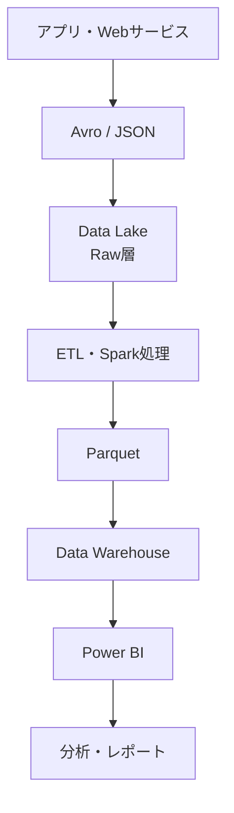
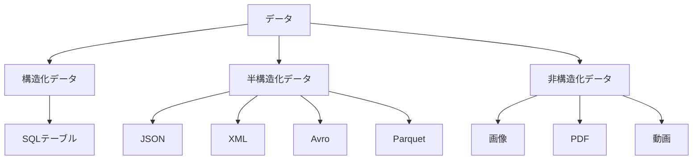
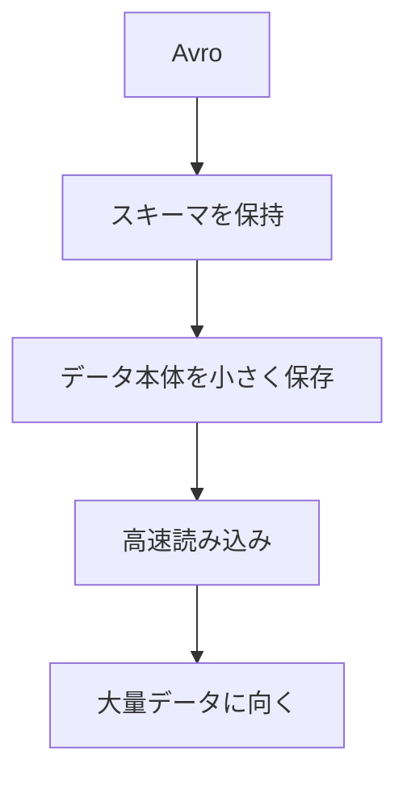
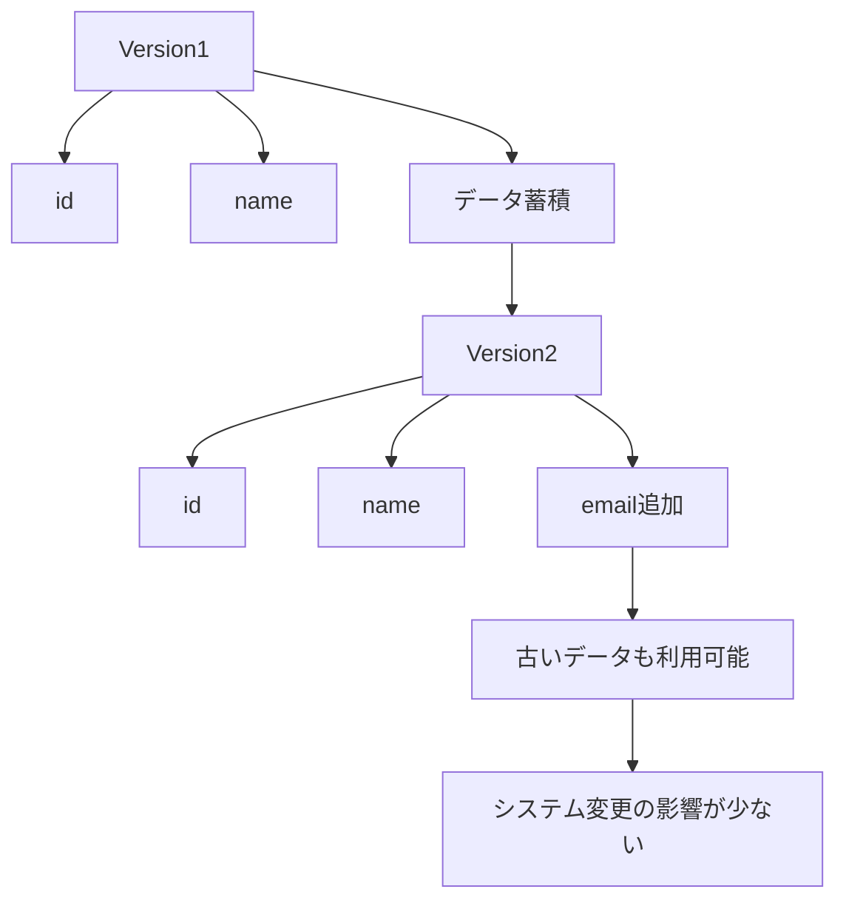
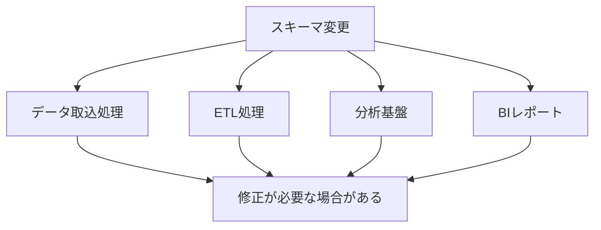
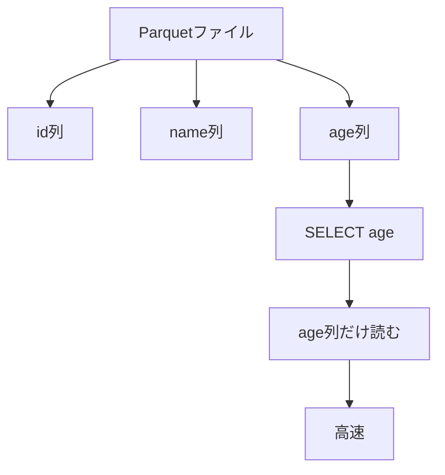
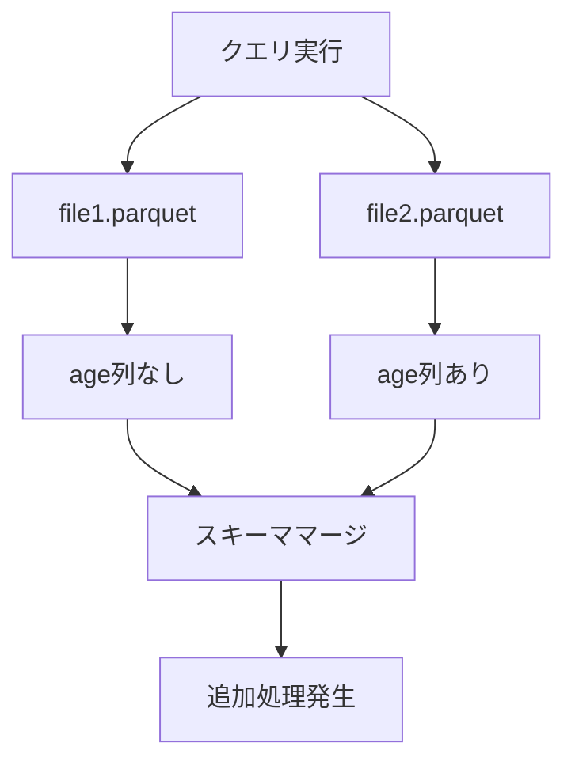
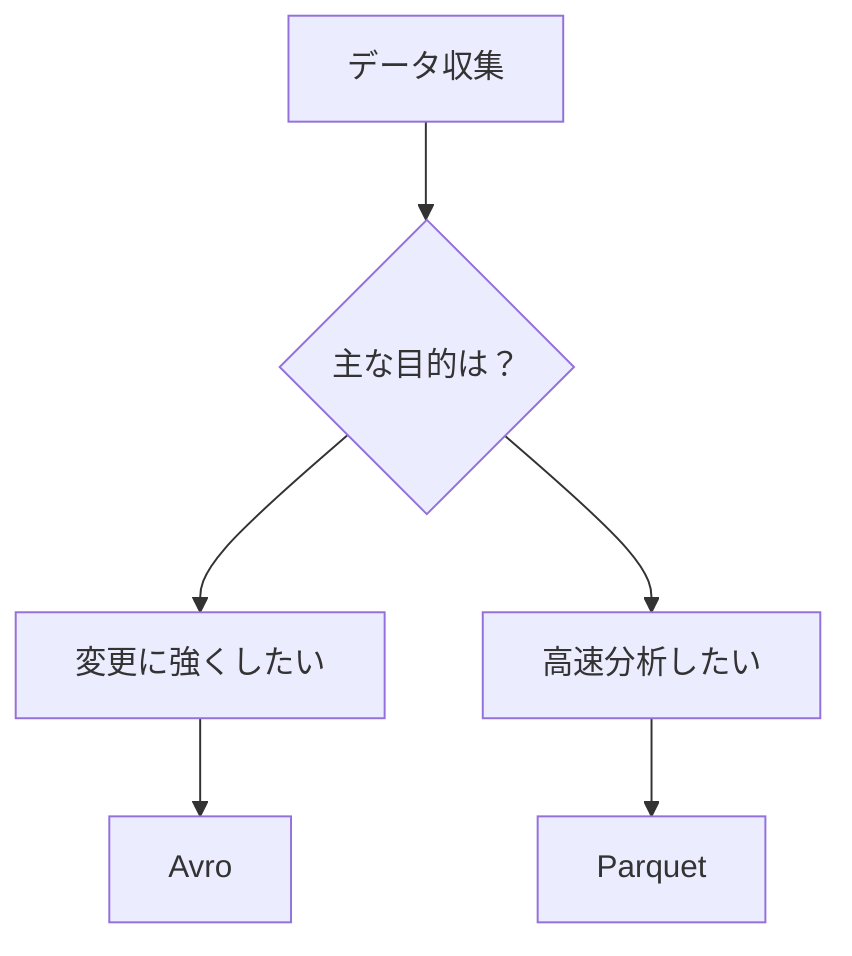
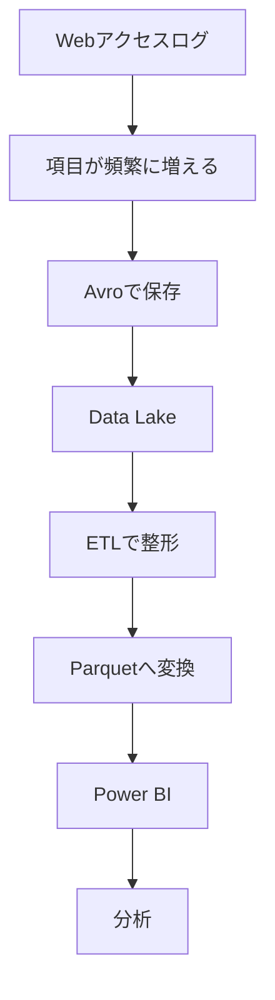
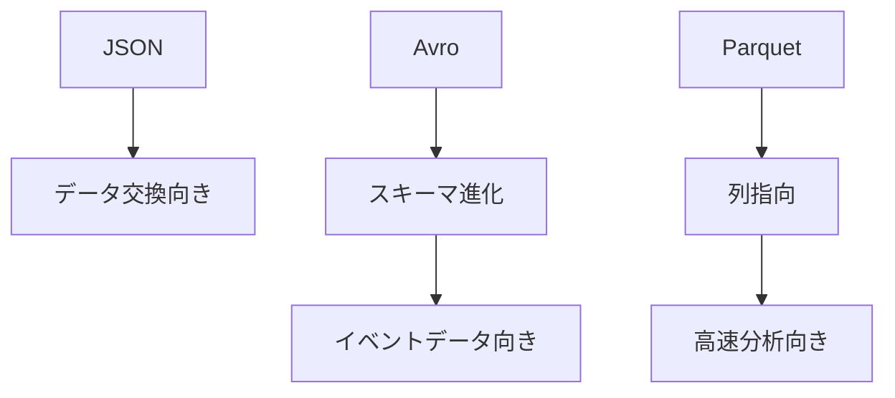

# Avro と Parquet の違いまとめ

## 結論

- **Avro はデータの受け渡し・蓄積向け**
  - スキーマ変更に強い
  - イベントログやストリーミングデータに向く
  - Schema Evolution（スキーマ進化）が得意

- **Parquet は分析向け**
  - 列指向ストレージ
  - 高圧縮
  - 集計や検索が高速
  - データウェアハウスや BI に向く

実務では次のような流れがよく採用される。



---

# Avro はなぜ半構造化データなのか

半構造化データとは、

> 構造（スキーマ）を持つが、厳密なテーブル構造に固定されていないデータ

のこと。



---

# JSON と Avro の違い

## JSON

JSON はデータの中にフィールド名を毎回持つ。

```json
{
  "id": 1,
  "name": "Tanaka",
  "age": 30
}
```

レコード数が増えるほど、

```text
"id"
"name"
"age"
```

という文字列が何度も保存される。

---

## Avro

Avro はスキーマを別管理する。

### スキーマ

```json
{
  "fields": [
    {"name":"id","type":"int"},
    {"name":"name","type":"string"},
    {"name":"age","type":"int"}
  ]
}
```

### データ

```text
1,Tanaka,30
2,Suzuki,25
```

そのため、



---

# Avro がスキーマ変更に強い理由

例えば最初は以下の構造だったとする。

```text
id
name
```

---

その後、

```text
id
name
email
```

へ変更されたとする。

---

Avro ではフィールド追加時に、

```json
{
  "name":"email",
  "type":["null","string"],
  "default":null
}
```

のような定義が可能。

---

古いデータ

```json
{
  "id": 1,
  "name": "Tanaka"
}
```

を新しいスキーマで読むと、

```json
{
  "id": 1,
  "name": "Tanaka",
  "email": null
}
```

として扱える。

---

これを Schema Evolution と呼ぶ。



---

# なぜスキーマ変更が問題になるのか

実際のデータ基盤では、

- ETL
- Spark
- Data Factory
- Power BI
- Synapse

など複数の仕組みが同じデータを利用している。

列を追加すると、



データ量が数TB〜PBになると影響が大きくなる。

---

# Parquet が分析向きな理由

Parquet は列指向ストレージ。

通常の行指向データ。

```text
1,A,30
2,B,25
3,C,40
```

---

Parquet は列ごとに保存する。

```text
id列
1
2
3

name列
A
B
C

age列
30
25
40
```

---

そのため、

```sql
SELECT age
FROM Customers
```

を実行すると、



不要な列を読まなくて済む。

---

# Parquet がスキーマ変更にやや弱い理由

古いファイル。

```text
id
name
```

新しいファイル。

```text
id
name
age
```

---

データレイクに混在すると、

分析エンジンは

- age 列は存在するか
- NULL を入れるべきか
- 型は一致するか

を判断する必要がある。



つまり、

**Parquetでもスキーマ変更は可能だが、得意分野ではない。**

---

# Avro と Parquet の使い分け



---

# 実務でのイメージ



---

# DP-900 試験向け暗記ポイント

## JSON

- 半構造化データ
- 人が読みやすい
- API連携向き

## Avro

- 半構造化データ
- バイナリ形式
- スキーマを持つ
- Schema Evolution をサポート
- イベントデータ向き

## Parquet

- 半構造化データ
- 列指向ストレージ
- 高圧縮
- 高速集計
- 分析向き

---

# 最重要まとめ



- **JSON = データ交換**
- **Avro = スキーマ変更に強い**
- **Parquet = 高速分析**
- **生データ保存 = Avro / JSON**
- **分析用データ = Parquet**
