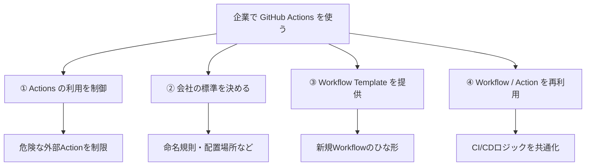
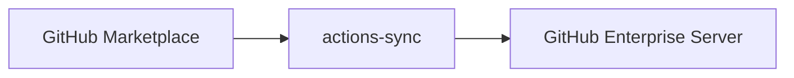
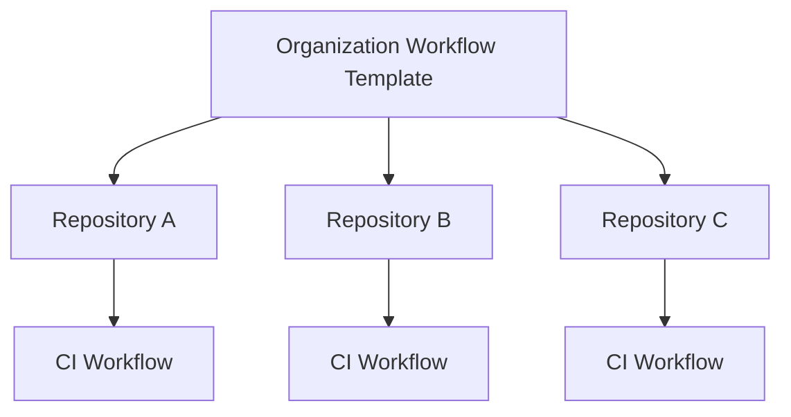

# GitHub Enterprise での Actions と Workflow の管理

## 1. このページの目的

GitHub Enterprise 環境では、各リポジトリの開発者が自由に GitHub Actions を作るだけではなく、**企業全体で安全性・標準化・再利用性を管理する**ことが重要になる。

大きく次の4つに整理できる。



---

# 2. Enterprise レベルで GitHub Actions の利用を制御する

GitHub Actions では、Workflow からさまざまな Action を呼び出せる。

例えば GitHub 公式の Action：

```yaml
steps:
  - uses: actions/checkout@v4
```

だけでなく、Marketplace などで公開されているサードパーティ製 Action も利用できる。

```yaml
steps:
  - uses: some-company/some-action@v1
```

便利な一方、企業から見ると、

> その外部 Action を社内リポジトリで実行して本当に安全なのか？

という問題が発生する。

そのため GitHub Enterprise では、Enterprise レベルで **GitHub Actions の利用ポリシー**を設定できる。

---

## 3. Actions Policy の考え方

Enterprise 管理者は、例えば次のような制御を行える。

```text
Enterprise
│
├─ Organization A
│   └─ GitHub Actions：利用可能
│
├─ Organization B
│   └─ GitHub Actions：利用可能
│
└─ Organization C
    └─ GitHub Actions：利用不可
```

さらに、Actions を利用可能にした Organization 内で、

```text
GitHub公式Action
→ OK

Enterprise内のAction
→ OK

許可された外部Action
→ OK

その他の外部Action
→ NG
```

のように制限することもできる。

つまり Enterprise の Actions Policy は、

> **企業全体で「どの GitHub Actions を利用してよいか」というガードレールを作る仕組み**

と考えると分かりやすい。

---

# 4. GitHub Enterprise Server と Public Action

GitHub Enterprise Server（GHES）は、企業が管理する環境に GitHub を構築する。

そのため環境によっては、

```text
GitHub.com / Marketplace
          │
          ×
          │
Enterprise Server
```

のように、インターネット側の Action を自由に取得させたくない場合がある。

そこで、必要な Public Action を Enterprise Server 側へ同期する方法が用意されている。

そのために利用できるのが `actions-sync`。



これにより、

> Marketplace から開発者が自由に Action を取得するのではなく、企業が必要と判断した Action を Enterprise Server に用意する

という管理ができる。

---

# 5. Organization レベルでは「標準化」する

Enterprise レベルが、

> **何を利用してよいか**

を管理するのに対して、Organization レベルでは、

> **GitHub Actions をどのように使うか**

を標準化する。

例えば、多数の Repository で開発者がそれぞれ自由に Workflow を作ると、

```text
Repository A
└─ ci.yml

Repository B
└─ build.yml

Repository C
└─ ci-test.yml

Repository D
└─ workflow.yml

Repository E
└─ main.yml
```

のようにバラバラになり、管理が難しくなる。

そのため組織として、例えば次のようなルールを文書化する。

- Repository の構成
- ファイル・フォルダーの命名規則
- 共有コンポーネントの配置場所
- 継続的なメンテナンス方法
- コントリビューションのガイドライン
- GitHub Actions の標準的な構成

---

# 6. Workflow Template

各 Repository で毎回 Workflow をゼロから作ると、同じような YAML が大量に作られる。

例えば、

```yaml
name: CI

on:
  pull_request:

jobs:
  test:
    runs-on: ubuntu-latest
    steps:
      # ...
```

を何度も作成することになる。

そこで Organization 側で、

> この種類のプロジェクトでは、この Workflow をベースに作ってください

という **Workflow Template** を用意できる。



Workflow Template は、

> **新しい Workflow を作成するときのひな形**

と考える。

---

# 7. Workflow Template のファイル構成

Workflow Template は Organization の `.github` Repository で管理できる。

例えば次のような構成になる。

```text
.github
└── workflow-templates
    ├── octo-organization-ci.yml
    └── octo-organization-ci.properties.json
```

2種類のファイルをセットで使用する。

### Workflow 本体

```text
octo-organization-ci.yml
```

GitHub Actions で実行する Workflow を定義する。

### Metadata

```text
octo-organization-ci.properties.json
```

GitHub の画面で Workflow Template をどのように表示するかを定義する。

---

# 8. properties.json

例えば次のような JSON を用意する。

```json
{
  "name": "Octo Organization Workflow",
  "description": "Octo Organization CI workflow template.",
  "iconName": "example-icon",
  "categories": ["Go"],
  "filePatterns": [
    "package.json$",
    "^Dockerfile",
    ".*\\.md$"
  ]
}
```

主な*目：

| 項目 | 役割 |
|---|---|
| `name`*| Template の名前 |
| `description` |*Template の*明 |
| `iconName` | 表示するアイ*ン |
| `categories` | Template のカテゴ* |
| `filePatterns* | どの Repository に Template を表示*るか判断するパ*ーン |

例えば、

```json
"filePatterns"* ["package.json$"]
```

なら、

```te*t
Repository
    ↓
package.json が存**    ↓
Node.js 系 Repository と判断
   *↓
関連する Workflow Template を候補として表示
*`*

という使い方ができる。

---

# 9* Workflow Template と Reusable Work*low

この2つは名前が*ているが、目的が異なる。

## Workflow Template*
Workflow を**作成するためのひな***。

```text
Workflow Template
   *   ↓
   テ*プレート利用
       ↓
Repository A
*github/workflows/ci.yml
```

つまり、
** Workflow を「作る」ときに再利用する

もの。

---
*## Reusable Workflow

Reusable Wor*flow は、

***通の Workflow そのものを別* Workflow から呼び出す仕組み***

```text
Repository A ─┐
        *    *│
Repository B ─┼──→ 共通 CI Workflo*
              │
Repository C ─┘
*``

共通 Workflow 側では `workflow_call* を*用する。

例：

```yaml
name: CI Pipelin*

on:
  workflow_call:
    inputs:*      node-version:
       *required: true
        type: strin*

jobs:
  build:
    runs-on: ubun*u-latest

    steps:
      - uses:*actions/checkout*v4

      - uses: actions/setup-no*e@v4
        with:
          node-*ersion: ${{ inputs.node-version }}*
      - run: npm install

      -*run: npm test
*``

利用する側では `uses` * Workflow を呼び出す。

```yaml
jobs*
  test:
    uses: org/reusable-wo*kflows/.github/work*lows/ci-pipeline.yml@v1
    with:
*     node-version: '20'
```

つまり、
*```text
Workflow Template
*
Workflowを「作る」と*に再利用


Reusable Workflow
↓
Workflo*を「実行*る」ときに共通Workflowを呼び出*
```

という違い。

---

#*10. Reusable / Custom Action

さらに小*い単位で処理を共通化でき*のが Custom Action。

例えば CI に*

```text
CI Workflow
*
├─ checkout
├─ Node.js setup
├─ n*m*install
├─ test
└─ deploy
```

という*理があった場合、

```text
Node.js setup
*
npm install
```

などの*通処理を Action にまとめることができる。

```*ermaid
flowchart TD
    Workflow["*I Workflow"]

    Workflow --> Che*kout["checkout"]
    Workflow --> *ustom["Custom Action"]
    Workflo* --> Test["test"]

    Custom --> *etup["Node.js setup"]
    Custom -*> Install["npm install*]
```

これにより複数の Workflow で同じ処*を何度も記述する必要がなくなる。

*--

# 11. 3つの再利用*法の違い

| 種類 | 目的 | イメ*ジ |
|---|---|---|
| Workflow Templ*te | Workflow 作*時のひな形 | 設計図をコピー*|
| Reusable Workflow | Workflow 全*の共通* | 共通 Workflow を呼ぶ |
| Custom Acti*n | 特定処理の共通化 | 共通処理を*ぶ |

最も簡単に整理すると、

```text
Workflow*Template
→ 設計図を再利用


Reusable Work*low*→ Workflowを再利用


Custom Action
→ 処*を再利用
```

---

# 12. な* Reusable Workflow が必要なのか

例えば100*の Repository に同*ような CI があるとする。

```text
100*Repository
      ×
同じような CI Workfl*w*```

各 Repository の `ci.yml` に同*処理を書いていると、CI*の標準を変更すると*に多数の Workflow を修正する必要がある。

*こで、

```mermaid
flowchart LR
    A*"Repo*A"] --> Common["Reusable CI"]
    *["*epo B"] --> Common
    C["Repo C"]*--> Common

    Common --> Checkou*["checkout"]
    Common --> Setup[*setup"]
    Common --> Test["test"*
    Common --> Security["security*scan"]
```

のように共通化する。

これにより、

- *I/CD の構成を統一できる
-*YAML の重複を減らせる
* メンテナンス箇所を減ら*る
- セキュリティチェックなどの企業*準を適用しやすい

*いったメリットがある。

---

# *3. Enterprise と Organization の役割

*回の内容では、Enterprise と Organization の*割を分けて考えると理解しやすい。

```mermaid
flowc*art TD
    Enterprise["Enterprise"*

    Enterprise --> Policy["Actio*s Policy"]
    Enterprise --> OrgA*"Organization A"]
    Enterprise -*> OrgB["Organization B"]

    OrgA*--> Standard["Workflow標準"]
    Org* --> Template["Workflow Template"]*    OrgA --> Reusable["Reusable Wo*kflow"]

    OrgB --> Repos["Repos*tories"]
```

## Enterprise レベル

主*、

> **何を許可するか**

を管理する。

例えば、

- *itHub Actions を利用可能にするか
- どの Organ*zation で利用可能にするか
- どの Action を利用可能*するか
- 外部 Action をどこまで許可するか

---

#* Organization レベル

主に、

> **どのように使****

を標準化する。

例えば、

- Workflow の標準*- Workflow Template
- Reusable Wor*flow
- Custom Action
- 命名規則
- Repo*itory 構成

などを管理する。

---

# 14. 全体像*
```mermaid
flowchart TD
    Enter*rise["GitHub Enterprise"]

    Ent*rprise --> Security["利用ポリシー"]
    *nterprise --> Organization["Organi*ation"]

    Security --> Allow["許*するAction"]
    Security --> Deny["*止するAction"]

    Organization --> *tandard["会社標準"]
    Organization -*> Template["Workflow Template"]
  * Organization --> ReusableWorkflow*"Reusable Workflow"]
    Organizat*on --> CustomAction["Custom Action*]

    Template --> Create["Workfl*w作成を標準化"]
    ReusableWorkflow -->*CommonCI["CI/CD全体を共通化"]
    Custom*ction --> CommonLogic["特定処理を共通化"]
*``

---

# 15. 最低限覚えるポイント

## ① En*erprise Policy

```text
GitHub Act*onsで
「何を使ってよいか」

を企業全体で制御する
```

-*-

## ② Workflow Template

```text*新しいWorkflowを作るための
「ひな形」
```

---

*# ③ Reusable Workflow

```text
共通の*orkflowそのものを
別のWorkflowから呼び出す
```
*---

## ④ Custom Action

```text
W*rkflow内の
特定の処理を共通化する
```

---

# 1*. 一言でまとめる

```text
各Repositoryで
*由にGitHub Actionsを書く
        ↓
Repo*itoryが増える
        ↓
管理が難しくなる
     *  ↓

Enterprise Policy
→ 安*性を管理
→ 「何*使ってよいか」


Organization Standard*→ 運用を標*化
→ 「どう使うか」


Workflow Template
→*Workflow作成を標準化
→ 「この*な形から作る」


Reusable Workflow
* CI/CD全体を共通化
→ 「*通Workflowを呼ぶ」


Custom Action
→ 個*処理を共通化
→ 「共通処*を呼ぶ」
```

前の「GitHub Enterprise モ*ル」の学習とつなげると、

```text
前*ページ
↓
GitHub Enterpriseとは*か
GHEC / GHES / Standard user*/ EMU


今回のページ
↓
Enterprise*境で
GitHub Actionsをどう統制・標*化・再利用するか
```

という関係になる。
````*
