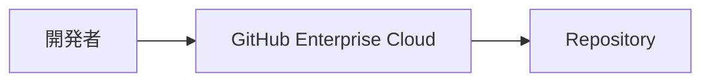
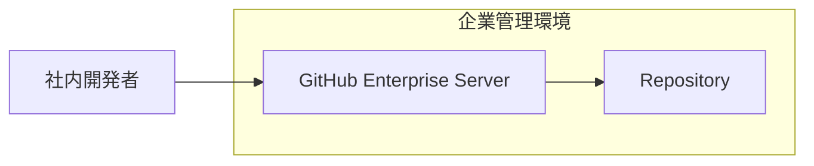
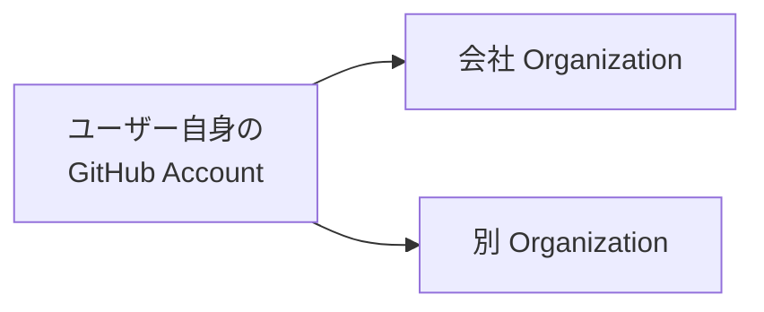
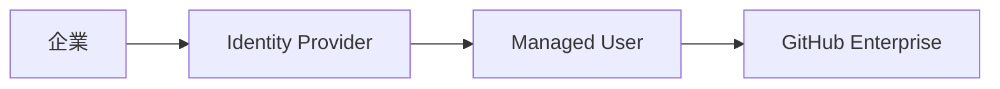
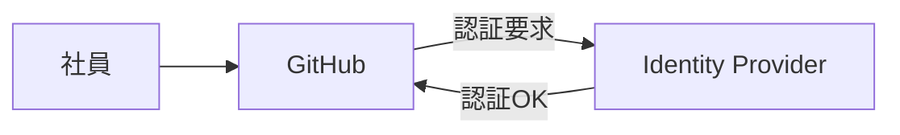
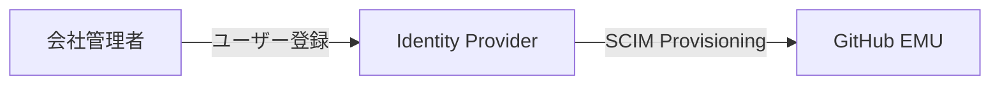
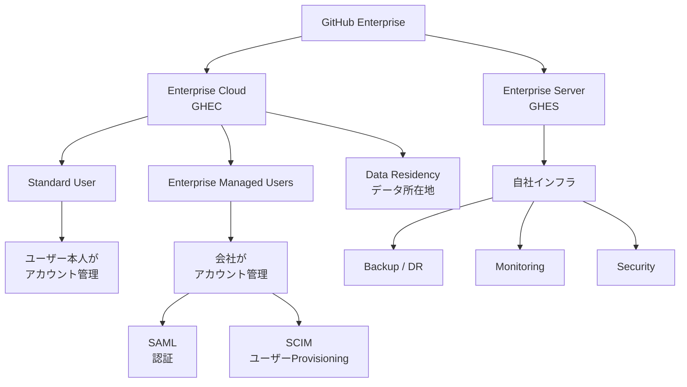

# GitHub Enterprise モデル 学習メモ

## 1. 全体像

GitHub Enterprise を理解するときは、まず次の **2つの軸を分けて考える**。

1. **GitHub をどこで動かすか**
   - GitHub Enterprise Cloud（GHEC）
   - GitHub Enterprise Server（GHES）

2. **GitHub ユーザーを誰が管理するか**
   - Standard user
   - Enterprise Managed Users（EMU）

```text
GitHub Enterprise
│
├─ GitHub Enterprise Cloud（GHEC）
│    │
│    ├─ Standard user
│    │    └─ 個人のGitHubアカウントを会社に参加させる
│    │
│    └─ Enterprise Managed Users（EMU）
│         └─ 会社がGitHubアカウントを管理する
│
└─ GitHub Enterprise Server（GHES）
     │
     └─ GitHubそのものを会社の環境に構築・運用する
```

---

# 2. GitHub Enterprise Cloud（GHEC）

GitHub Enterprise Cloud（GHEC）は、**GitHub が提供・運用するクラウド環境を企業向けに利用するモデル**。

普段利用する GitHub.com の延長線上として考えると分かりやすい。



サーバー自体は GitHub 側が運用する。

そのため企業側で GitHub サーバーそのものを構築・運用する必要がない。

主な特徴：

- GitHub のクラウド環境を利用
- 一元化されたユーザー管理
- SSO
- SAML
- SCIM
- 監査ログ
- データ所在地（Data Residency）への対応
- GitHub 側によるインフラ運用

### 覚え方

> **GHEC = GitHub にインフラ運用を任せるクラウド版**

---

# 3. GitHub Enterprise Server（GHES）

GitHub Enterprise Server（GHES）は、

**GitHubそのものを企業の管理する環境に構築するモデル**。

例えば、

- オンプレミス
- プライベートクラウド

などに GitHub Enterprise Server を構築する。



例えば、

> ソースコードを GitHub.com 上に保存すること自体がセキュリティ要件上認められない

という企業では GHES が候補になる。

自由度が高い一方、

**GitHub Server 自体を企業側で運用する責任が発生する。**

企業側で管理するものには、例えば次のようなものがある。

- サーバー
- CPU / RAM などのリソース
- バックアップ
- Disaster Recovery
- アップデート
- モニタリング
- セキュリティ
- ログ

### 覚え方

> **GHES = GitHub を自分たちで持つセルフホスト版**

---

# 4. GHEC と GHES の違い

| 項目 | GHEC | GHES |
|---|---|---|
| 正式名 | GitHub Enterprise Cloud | GitHub Enterprise Server |
| GitHub の場所 | GitHub のクラウド | 自社管理環境 |
| インフラ管理 | GitHub | 企業 |
| バックアップなど | 基本的に GitHub 側 | 企業側 |
| 運用負荷 | 小さい | 大きい |
| 自由度 | 比較的低い | 高い |
| 主な利用理由 | GitHub に運用を任せたい | データや環境を自社側で完全に管理したい |

シンプルに覚えるなら、

```text
GHEC
↓
Cloud
↓
GitHubに運用を任せる


GHES
↓
Server
↓
自分たちでGitHubを運用する
```

---

# 5. Standard user

Standard user は、従来型の GitHub ユーザーモデル。

**GitHub アカウント自体はユーザー本人が管理する。**

例えば、

```text
自分のGitHub Account
        ↓
会社のOrganizationに招待される
```

という関係になる。

主な特徴：

- ユーザーが自分のアカウントを管理
- ユーザー名を自分で管理
- メールアドレスを自分で管理
- 個人設定を自分で管理
- Organization / Enterprise には招待で参加する

イメージ：



重要なのは、

> **アカウントは個人のもの。会社の Organization に参加している**

という点。

---

# 6. Enterprise Managed Users（EMU）

Enterprise Managed Users（EMU）は、

**企業が GitHub アカウント自体を管理するモデル**。

Standard user とはここが大きく異なる。



主な特徴：

- ユーザーアカウントを企業が管理
- 認証を企業の Identity Provider と統合
- ユーザー名を企業側で管理
- メールアドレスを企業側で管理
- アカウントの作成・無効化などを企業側で管理
- 管理された Enterprise の外で自由に利用することに制限がある

Standard user が、

> **私の GitHub アカウント**

なのに対して EMU は、

> **会社から提供・管理されている GitHub アカウント**

と考えると分かりやすい。

---

# 7. Standard user と EMU の違い

| 項目 | Standard user | EMU |
|---|---|---|
| アカウント管理 | ユーザー本人 | 企業 |
| ユーザー名 | ユーザー管理 | 企業管理 |
| メールアドレス | ユーザー管理 | 企業管理 |
| Organization 参加 | 招待 | 企業管理 |
| アカウントライフサイクル | ユーザー中心 | 企業中心 |
| Identity Provider との統合 | 必須ではない | 中心的に利用 |

覚え方：

```text
Standard
↓
「自分のGitHubアカウント」


EMU
↓
「会社の管理するGitHubアカウント」
```

---

# 8. SAML と SCIM

Enterprise のユーザー管理では、

- SAML
- SCIM

という用語が登場する。

最初は次のように整理すると分かりやすい。

```text
SAML
↓
「あなたは誰ですか？」
↓
認証


SCIM
↓
「この人のアカウントを作る・更新する・無効化する」
↓
ユーザー管理 / Provisioning
```

---

## SAML

SAML は主に **認証** に関係する。

例えば、



つまり、

> GitHub 自体が社員のID・パスワードを直接確認するのではなく、企業の Identity Provider を使って本人確認する

という考え方。

### 覚え方

> **SAML = Authentication（認証）寄り**

---

# 9. SCIM

SCIM は主に **ユーザーの Provisioning** に関係する。

Provisioning とは、

> 必要なユーザーアカウントを作成・更新・無効化すること

と考えると分かりやすい。

例えば社員が入社した場合：



逆に社員が退職した場合は、企業の Identity Provider 側の変更に合わせて GitHub のアクセスを無効化するといった管理が可能になる。

### 覚え方

> **SCIM = Provisioning（ユーザー管理）寄り**

---

# 10. SAML と SCIM の違い

```text
ユーザーがログインする
        ↓
      SAML
        ↓
「この人は本当に社員？」
        ↓
      認証


社員が入社する
        ↓
      SCIM
        ↓
「GitHubアカウントを用意する」
        ↓
   Provisioning
```

つまり、

```text
SAML
=
Authentication


SCIM
=
Provisioning
```

と整理すると覚えやすい。

---

# 11. Data Residency

Data Residency は、

**データをどの地域に保存するか**

という考え方。

例えば、

```text
Company
   ↓
GitHub Enterprise Cloud
   ↓
Europe Region
   ↓
Repository
Issue
Pull Request
Metadata
```

のように、企業のコンプライアンス要件などに合わせてデータ所在地を管理する。

対象となるデータには、

- Repository の内容
- Issue
- Pull Request
- Repository 関連データ
- 監査ログ
- ユーザーイベント
- 設定などのメタデータ

などがある。

つまり、

> **クラウドを利用したいが、データを保存する地域についても企業のコンプライアンス要件を満たしたい**

という場合に重要になる。

---

# 12. 全体の関係



---

# 13. 一番重要な整理

GitHub Enterprise を理解するとき、

**GHEC / GHES と Standard / EMU を同じ軸の選択肢として考えない。**

```text
【GitHubをどこで動かす？】

GHEC
→ GitHubのCloud

GHES
→ 自社管理Server
```

一方、

```text
【GitHubアカウントを誰が管理する？】

Standard user
→ ユーザー本人

EMU
→ 企業
```

という別々の話。

---

# 14. 最低限覚えること

まずは次の5つを押さえる。

```text
GHEC
= GitHubが運用するクラウド版

GHES
= 企業が自分で運用するセルフホスト版

Standard user
= 個人がGitHubアカウントを管理

EMU
= 会社がGitHubアカウントを管理

SAML = 認証
SCIM = ユーザーProvisioning
```

## 一言でまとめる

```text
GHEC vs GHES
    ↓
「GitHubをどこで動かす？」


Standard vs EMU
    ↓
「GitHubユーザーを誰が管理する？」


SAML vs SCIM
    ↓
「認証する？」or「ユーザーを管理する？」
```

この3つの比較軸を分けて理解すると、GitHub Enterprise の構成を整理しやすくなる。
