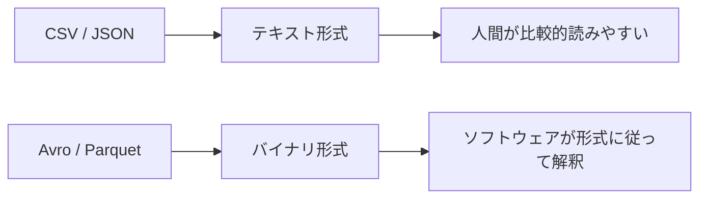
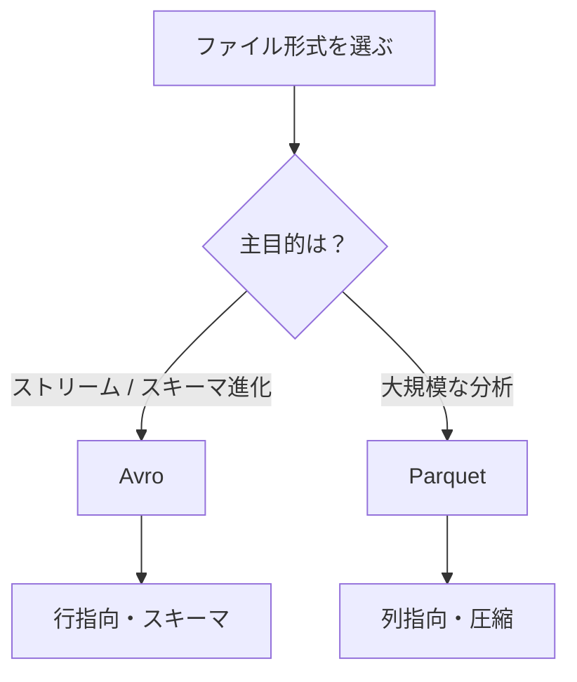
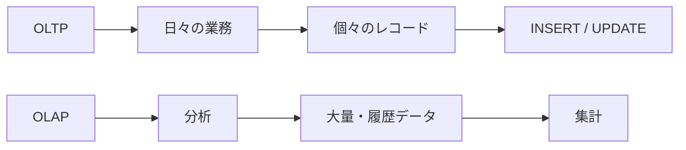
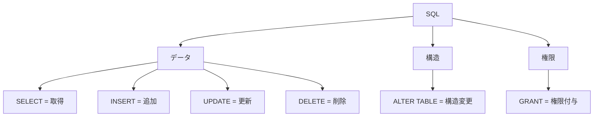
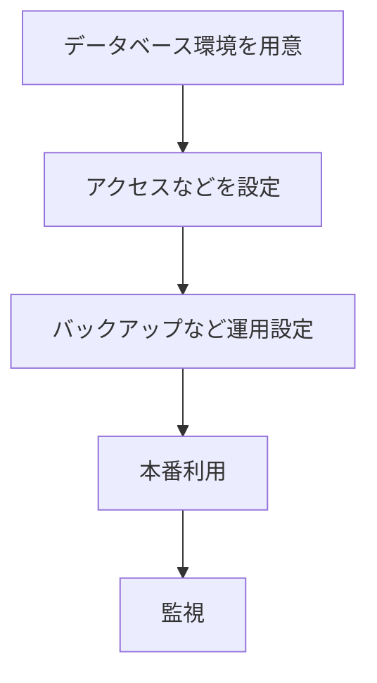
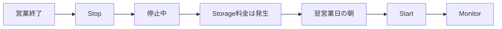
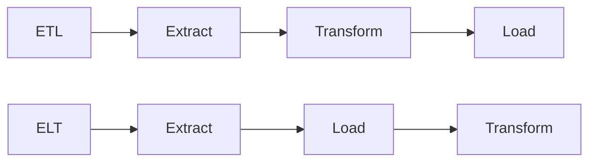
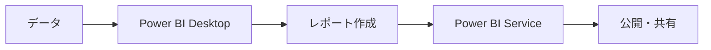
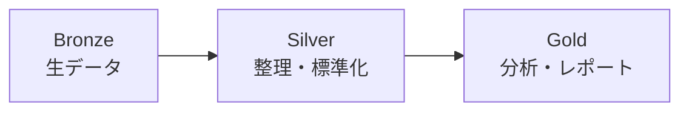

# DP-900 模擬試験 50問 振り返り・復習ポイント

## 1. 今回の結果

- 問題数：50問
- 不正解：12問
- 特に優先して復習する分野：
  1. CSV / JSON / Avro / Parquet の違い
  2. OLTP / OLAP の違い
  3. SQLステートメントの役割
  4. Azureサービスの用途
  5. データ関連職種の役割
  6. データベースのプロビジョニング
  7. Compute / Storage の課金
  8. ETL / ELT
  9. Power BI Desktop / Power BI Service
  10. PartitionKey / RowKey

---

# 2. 最優先：ファイル形式

該当問題：

- Q10
- Q12
- Q38

複数の問題で間違えているため、最優先で復習する。

特に、

- Avro と Parquet
- テキスト形式とバイナリ形式
- 行指向と列指向
- ストリーミング向けと分析向け

の区別が重要。

## CSV / JSON / Avro / Parquet

| 形式 | 大まかな特徴 | 覚え方 |
|---|---|---|
| CSV | テキスト、単純な表形式 | シンプルな表 |
| JSON | テキスト、半構造化 | 柔軟な構造 |
| Avro | バイナリ、行指向、スキーマ | スキーマ進化・ストリーム |
| Parquet | バイナリ、列指向、圧縮 | 大規模分析 |

### 試験用の覚え方

```text
CSV     = シンプルな表
JSON    = 柔軟な半構造化データ
Avro    = 行・スキーマ進化・ストリーム
Parquet = 列・分析
```

---

## Avroとは？

Avroはバイナリ形式のデータフォーマット。

重要なのは、

```text
Avro
↓
スキーマを扱える
↓
スキーマの変更に対応しやすい
↓
ストリーミングデータなどで利用
```

例えば、IoTデータが最初は、

```json
{
  "deviceId": "A001",
  "temperature": 25
}
```

だったとして、後から、

```json
{
  "deviceId": "A001",
  "temperature": 25,
  "humidity": 60
}
```

のように `humidity` が追加される。

このようにデータ構造が変化していくことを、

**Schema Evolution（スキーマ進化）**

という。

### 試験でのキーワード

```text
IoT
Streaming
Schema
Schema Evolution
新しいフィールドの追加
```

これらが出たら、

**Avro**

を候補にする。

---

# 3. バイナリ形式とは？

CSVやJSONはテキストなので、人間が直接読める。

例えばJSON：

```json
{
  "name": "Hiroki",
  "age": 30
}
```

CSV：

```text
Hiroki,30
```

一方、AvroやParquetなどのバイナリ形式は、人間が直接読むことを主目的にした形式ではない。

概念的には、

```text
[48][69][72][6F][6B][69]...
```

のようなバイト列として格納され、対応するソフトウェアやライブラリが形式のルールに従って解釈する。



### 試験対策

「バイナリ = 0と1」とだけ覚えるのではなく、

```text
テキスト
→ 人間が直接読みやすい

バイナリ
→ コンピューターによる保存・処理を意識した形式
```

と理解する。

---

# 4. Avro vs Parquet

今回もっとも重要な比較。

## Avro

```text
行指向
スキーマ
スキーマ進化
ストリーミング
```

## Parquet

```text
列指向
圧縮
大量データ
分析処理
```

### 覚え方

```text
Avro
→ スキーマ・ストリーム

Parquet
→ 列・分析
```



### Parquetを判断する重要ワード

問題文に、

```text
columnar
analytics
large-scale analytics
compressed
```

などが出てきたら、Parquetを強く疑う。

---

# 5. ファイル形式の最適化

模擬問題では、

**最も最適化されていない形式 → 最も最適化された形式**

として、

```text
CSV
↓
JSON
↓
Avro
↓
Parquet
```

という順序が問われた。

ただし、この順番を単純な「ファイル形式の優劣」として暗記するのではなく、

```text
CSV
→ 単純なテキスト

JSON
→ 柔軟なテキスト / 半構造化

Avro
→ バイナリ / スキーマ

Parquet
→ 列指向 / 分析
```

という用途の違いを理解する。

---

# 6. OLTP vs OLAP

該当：

- Q29

## OLTP

Online Transaction Processing

日々の業務処理を扱う。

例：

```text
商品の注文
銀行取引
顧客登録
在庫更新
```

特徴：

```text
個々のレコード
INSERT / UPDATE
大量の小さなトランザクション
最新の業務データ
```

## OLAP

Online Analytical Processing

データ分析を扱う。

例：

```text
年間売上を分析
地域別売上を集計
商品カテゴリ別に比較
過去数年間の傾向を分析
```

特徴：

```text
読み取り中心
履歴データ
集計
大量データ
ディメンションによる分析
```

### 覚え方

```text
OLTP = 日々の業務
OLAP = 集めて分析
```



### 自己チェック

1. 1件の注文を登録する処理はOLTPとOLAPのどちらか？
2. 過去5年間の地域別売上を集計する処理はどちらか？

---

# 7. SQLステートメント

該当：

- Q42

今回混同したもの：

```text
SELECT ↔ GRANT
UPDATE ↔ ALTER TABLE
```

正しくは、

```text
SELECT
→ データ取得

INSERT
→ 新規データ追加

UPDATE
→ 既存データ変更

DELETE
→ データ削除

ALTER TABLE
→ テーブル構造変更

GRANT
→ 権限付与
```

## データ・構造・権限に分ける



### SELECT vs GRANT

重要なのは、

```text
SELECT
→ 実際にデータを読む

GRANT SELECT
→ データを読む「権限」を与える
```

### UPDATE vs ALTER TABLE

```text
住所を変更
→ データを変更
→ UPDATE
```

```text
LoyaltyPoints列を追加
→ テーブル構造を変更
→ ALTER TABLE
```

### 試験用暗記

```text
SELECT = 見る
INSERT = 足す
UPDATE = 直す
DELETE = 消す

ALTER = 構造
GRANT = 権限
```

### 自己チェック

1. Customersテーブルのメールアドレスを変更する場合は？
2. CustomersテーブルにBirthDate列を追加する場合は？

---

# 8. Azureサービス：Event Hubs

該当：

- Q43

今回、

```text
Event Hubs
vs
Traffic Manager
```

を混同した。

## Event Hubs

重要キーワード：

```text
Event
Telemetry
Streaming
大量イベント
IoT
取り込み
```

試験では、

> 大量のデバイスから継続的に送信されるイベントデータを取り込む

というような問題ならEvent Hubsを候補にする。

## Traffic Manager

```text
DNS
トラフィック
ルーティング
可用性
```

データストリームを取り込むサービスではない。

### 覚え方

```text
Event Hubs
→ データを「取り込む」

Traffic Manager
→ トラフィックを「振り分ける」
```

### 自己チェック

1. 数百万台のIoTデバイスからテレメトリを受け取る場合は？
2. DNSベースでトラフィックを適切なエンドポイントへ振り分ける場合は？

---

# 9. データ関連職種

該当：

- Q1

役割の境界を整理する。

## Data Engineer

中心となる考え方：

```text
データの取り込み
データ変換
データパイプライン
分析用データの準備
```

## Data Analyst

中心となる考え方：

```text
データ分析
可視化
レポート
ダッシュボード
```

## Database Administrator（DBA）

中心となる考え方：

```text
データベース管理
セキュリティ
バックアップ
監視
可用性
```

### 覚え方

```text
Engineer = データを届ける仕組み
Analyst  = データから意味を見つける
DBA      = データベースを守る・管理する
```

---

# 10. データベースのプロビジョニング

該当：

- Q4

今回のポイントは、作業の依存関係。

例えば、



重要なのは、

```text
存在しないデータベース
↓
先に権限設定
```

とはならないこと。

並べ替え問題では、

**「後続の処理を実行するために、何が先に存在している必要があるか？」**

と考える。

---

# 11. Azure Database for MySQL：Stop / Start

該当：

- Q9

今回疑問に感じたポイント：

> 1日の作業なら朝のStartから考えるのでは？

これは自然な考え方。

しかし問題には、

```text
at the end of the business day
while the server is stopped
the next business morning
after restart
```

という時間関係が含まれていた。

そのため、問題が意図する時系列は、



となる。

## 重要ポイント

```text
Stop
≠
すべての料金がなくなる
```

今回の問題では、

```text
Compute
→ 停止によって課金を抑える

Storage
→ 停止中も存在
```

と分離して考える。

### 並べ替え問題のコツ

次の表現に注目する。

```text
before
after
next
while
at the end of
```

知識だけではなく、**時間を示す単語から依存関係を作る**。

---

# 12. ETL vs ELT

該当：

- Q31

基本的なデータ処理の流れは、

```text
運用データ
↓
データパイプライン
↓
分析用データ
↓
分析 / レポート
```

## ETL

```text
Extract
↓
Transform
↓
Load
```

つまり、

**取り出す → 変換する → 格納する**

## ELT

```text
Extract
↓
Load
↓
Transform
```

つまり、

**取り出す → 先に格納する → そこで変換する**



### 一番重要な違い

```text
ETL = Loadする前にTransform

ELT = LoadしてからTransform
```

---

# 13. Power BI Desktop vs Power BI Service

該当：

- Q36

## Power BI Desktop

主に、

```text
データ接続
分析
データモデル作成
レポート作成
```

## Power BI Service

主に、

```text
公開
共有
ブラウザーから利用
```

### 覚え方

```text
Desktop
→ 作る

Service
→ 公開・共有する
```



---

# 14. Azure Table Storage：PartitionKey vs RowKey

該当：

- Q40

今回の混同：

```text
PartitionKey
→ 一意の識別子
```

と考えてしまった。

正しく整理すると、

```text
PartitionKey
→ エンティティをグループ化

RowKey
→ パーティション内でエンティティを識別

PartitionKey + RowKey
→ エンティティを一意に識別
```

イメージ：

```text
PartitionKey = Tokyo

    RowKey = Customer001
    RowKey = Customer002
    RowKey = Customer003

PartitionKey = Fukuoka

    RowKey = Customer001
    RowKey = Customer002
```

つまり、

`Customer001` だけでは別パーティションにも存在できる。

```text
Tokyo + Customer001
```

のように、

```text
PartitionKey + RowKey
```

の組み合わせで考える。

### 覚え方

```text
PartitionKey = グループ
RowKey       = グループ内の識別
```

---

# 15. Bronze / Silver / Gold

今回の学習中に確認したメダリオン アーキテクチャ。

```text
Bronze
→ 未加工データ

Silver
→ クレンジング・標準化

Gold
→ 集計・分析・レポート
```

試験用には、

```text
Bronze = 生
Silver = 整理
Gold   = 分析・レポート
```

と覚える。



---

# 16. 今回のミスに見られる共通パターン

今回の12問を個別に見るより、共通点を見る。

特に多いのが、

**「似ている2つの概念の役割の違い」**

を問われた問題。

```text
Avro          vs Parquet
OLTP          vs OLAP
SELECT        vs GRANT
UPDATE        vs ALTER TABLE
Event Hubs    vs Traffic Manager
PartitionKey  vs RowKey
Desktop       vs Service
ETL           vs ELT
Compute       vs Storage
```

したがって、今後は単語を単独で覚えるのではなく、

```text
Aは何をする？
Bは何をする？
違いは何？
問題文のどのキーワードから判断する？
```

という形で比較して学習する。

---

# 17. 優先学習順

## 優先度1：複数回間違えている

```text
CSV / JSON / Avro / Parquet
           ↓
特に
Avro vs Parquet
```

ここを最優先。

---

## 優先度2：DP-900の基礎概念

```text
OLTP vs OLAP
SQL
ETL vs ELT
```

これらは他の問題を理解する基礎にもなる。

---

## 優先度3：Azureサービス・製品

```text
Event Hubs
Power BI
Azure Database for MySQL
Azure Table Storage
```

「サービス名 → 何をするサービスか」を結び付ける。

---

## 優先度4：役割・運用

```text
Data Engineer
Data Analyst
DBA

Database provisioning
Backup
Monitoring
Permissions
```

---

# 18. 次回の模擬試験で意識する判断方法

問題を読んだら、まずキーワードを探す。

## ファイル形式

```text
schema evolution / streaming
→ Avro

columnar / analytics
→ Parquet

plain text / rows and columns
→ CSV

semi-structured / flexible
→ JSON
```

## データ処理

```text
individual transactions
→ OLTP

aggregation / historical / analysis
→ OLAP
```

## SQL

```text
retrieve
→ SELECT

new row
→ INSERT

modify existing data
→ UPDATE

change table structure
→ ALTER TABLE

permission
→ GRANT
```

## Azureサービス

```text
event / telemetry / streaming ingestion
→ Event Hubs

DNS / traffic routing
→ Traffic Manager
```

## Power BI

```text
create report
→ Desktop

publish / share
→ Service
```

## Table Storage

```text
group
→ PartitionKey

unique within partition
→ RowKey
```

---

# 19. 最終暗記シート

```text
【ファイル】
CSV     = シンプルな表
JSON    = 半構造化
Avro    = 行・スキーマ・ストリーム
Parquet = 列・分析

【ワークロード】
OLTP = 日々の業務
OLAP = 集めて分析

【SQL】
SELECT = 見る
INSERT = 足す
UPDATE = 直す
DELETE = 消す
ALTER  = 構造
GRANT  = 権限

【Azure】
Event Hubs     = イベント取り込み
Traffic Manager = DNS・トラフィック振り分け

【パイプライン】
ETL = 変換してからLoad
ELT = Loadしてから変換

【Power BI】
Desktop = 作る
Service = 公開・共有

【Table Storage】
PartitionKey = グループ
RowKey       = グループ内の識別

【Medallion】
Bronze = 生
Silver = 整理
Gold   = 分析・レポート

【MySQL Stop】
Compute ≠ Storage
Stopしても「すべてのコストがなくなる」とは考えない
```

---

# 20. 次回の模擬試験での目標

単純に正解の選択肢を暗記するのではなく、

```text
① 問題文のキーワードを特定
        ↓
② 関連する概念を2つ程度に絞る
        ↓
③ 「A vs B」で違いを説明
        ↓
④ 要件に合う方を選ぶ
```

という判断を行う。

今回の復習で特に重視するのは、

**「名前を知っている」状態から「似た概念と比較して役割を説明できる」状態にすること。**

例：

```text
× Parquetを知っている

○ ParquetはAvroと何が違うか説明できる
○ 「columnar」という単語を見てParquetを判断できる
○ 「schema evolution」という単語を見てAvroを判断できる
```

この状態を目標に復習する。
