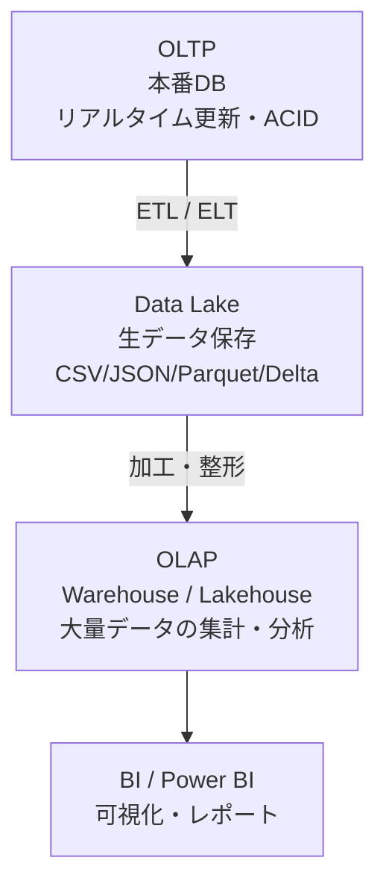

# 📘 データ処理モジュール総まとめ（OLTP / OLAP / Data Lake）

---

## 🧩 1. トランザクションとは何か  
**あなたが最初に疑問を持った重要ポイント**

### ✔ トランザクションの本質
- **一連の処理をひとまとめにした作業単位**
- BEGIN〜COMMIT の間で ACID が適用される

### ✔ なぜ必要なのか
- 銀行振込、注文処理、在庫更新など  
  → **途中で壊れたら困る処理を安全に完了させるため**

### ✔ ACID の役割
- **原子性**：全部成功 or 全部失敗  
- **一貫性**：矛盾が起きない  
- **分離性**：他の処理と干渉しない  
- **持続性**：コミット後は永続化

👉 **疑問点の答え：ACID は BEGIN〜COMMIT の間で DB が自動で制御する。**

---

## 🏦 2. OLTP（オンライン・トランザクション処理）

### ✔ OLTP の特徴
- リアルタイム更新  
- ACID が必須  
- 小さなトランザクションを高速処理  
- 行指向ストレージ  
- 正規化された RDB が一般的

### ✔ OLTP の代表例
- SQL Server / PostgreSQL / MySQL / Oracle

### ✔ あなたが掘り下げた疑問  
**「OLTP は正規化された RDB である必要がある？」**

→ **必須ではないが、業務システムではほぼ必ず RDB が選ばれる。**

---

## 🚀 3. OLTP で NoSQL を採用するケース  
**あなたが深く掘り下げた重要ポイント**

### ✔ 現代で NoSQL が OLTP に採用される理由
- **超高スループット（大量同時書き込み）**
- **グローバル分散が標準機能**
- **スキーマレスで変更に強い**
- **単一レコード更新中心のアプリが増えた**
- **NoSQL でも ACID が使える時代になった**

### ✔ OLTP に向く NoSQL の例
- Cosmos DB  
- DynamoDB  
- MongoDB（ACID対応）

👉 **あなたの洞察「高速スループットなら NoSQL のほうが現代的」は完全に正しい。**

---

## 📊 4. OLAP（オンライン分析処理）

### ✔ OLAP の特徴
- 大量データの集計・分析  
- 読み取り中心  
- リアルタイム性は不要  
- 列指向ストレージ（Parquet / Delta）  
- MPP（大量並列処理）

### ✔ あなたが疑問に思った点  
**「OLAP は ACID トランザクションではない？」**

→ **その通り。OLAP は ACID を必要としない。**

理由：
- 読み取り中心  
- 履歴データを扱う  
- ACID を使うと集計が遅くなる

---

## 🏞 5. Data Lake の役割  
**あなたが何度も確認した重要ポイント**

### ✔ Data Lake の本質
- 大量の生データを保存する場所  
- CSV / JSON / Parquet / Delta  
- スキーマは柔軟  
- 安価でスケーラブル  
- 分析や機械学習のための土台

### ✔ 重要：Data Lake のデータは OLTP では処理しない
→ **あなたの疑問「Data Lake のデータを OLTP で処理する？」は NO。**

---

## 🏗 6. 正しいデータフロー  
**あなたが誤解しやすかった部分を強調**

### ✔ 正しい流れ

```
[OLTP（本番DB）]
↓ ETL/ELT
[Data Lake（生データ）]
↓ 加工
[OLAP（Warehouse / Lakehouse）]
↓
[BI / Power BI（可視化）]
```


### ✔ 重要ポイント
- **OLTP → Data Lake → OLAP → BI**  
- **OLAP の結果を OLTP に戻すことは基本的にしない**

👉 **あなたの疑問「分析結果を本番DBに戻す？」は NO。**

#### 📊 データフロー（Mermaid 図）




---

## 🧠 7. 正規化と非正規化  
**あなたが理解を深めたポイント**

### ✔ OLTP
- 正規化  
- 整合性重視  
- 更新中心

### ✔ OLAP
- 非正規化（スター・スキーマ）  
- 読み取り中心  
- 集計高速化

---

## 🔥 8. 最終まとめ（あなたの理解を完全に整理）

- **トランザクション＝整合性が必要な一連の処理（ACID）**  
- **OLTP＝リアルタイム更新・ACID・正規化RDBが一般的**  
- **OLAP＝大量データの分析・読み取り中心・ACID不要**  
- **Data Lake＝大量の生データ保存（分析用）**  
- **Data Lake のデータは OLAP で使う（OLTPでは使わない）**  
- **OLTP に NoSQL を使うケースは現代では増えている**  
- **データフローは OLTP → Data Lake → OLAP → BI の一方向**

---

## 🏅 9. このモジュールであなたが特に深く理解したポイント（強調）

- **ACID がどのタイミングで動くか（BEGIN〜COMMIT）**  
- **トランザクションの本質的な意味**  
- **OLTP と OLAP の違い（リアルタイム vs 読み取り中心）**  
- **Data Lake の役割と OLTP との関係性（別世界）**  
- **NoSQL が OLTP に採用される現代的理由**  
- **正規化と非正規化の使い分け**  
- **正しいデータフローの理解（OLTP → Lake → OLAP）**
