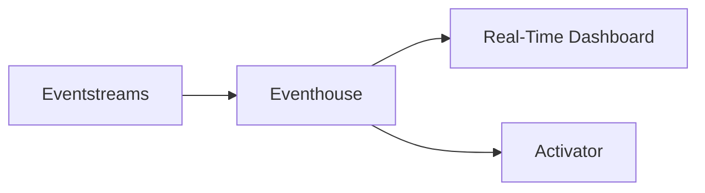
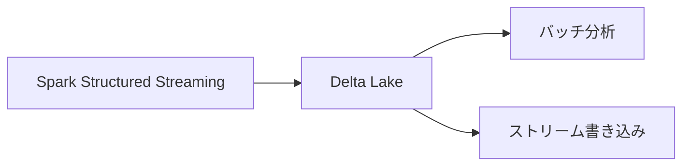
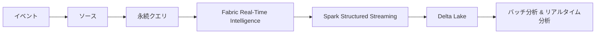

# 📘 ストリーム処理・Fabric・Spark まとめ（振り返り用）

---

## 1. バッチ処理 vs ストリーム処理

### 🟦 バッチ処理（Batch）
- データをまとめて一括処理
- 結果が出るまで遅延がある
- 大量データの複雑な分析に向く

### 🟩 ストリーム処理（Stream）
- データ到着と同時にリアルタイム処理
- ミリ秒〜秒単位で結果が出る
- 異常検知・リアルタイム監視に最適

### 🔍 違いまとめ
| 観点 | バッチ | ストリーム |
|------|--------|-------------|
| データ量 | 大量 | 小さな単位 |
| 待機時間 | 長い | 短い |
| 分析内容 | 複雑 | 軽量 |

---

## 2. ストリーム処理アーキテクチャの基本構成

```mermaid
flowchart LR
    A[イベント発生] --> B[ソースに取り込み<br>(Event Hubs / IoT Hub / Kafka / Storage)]
    B --> C[永続クエリでリアルタイム処理]
    C --> D[シンクへ出力<br>(Storage / DB / Dashboard / Queue)]
```

---

## 3. Microsoft Fabric Real-Time Intelligence

### 🟦 Real-Time Hub
- 組織内のストリーミングデータを一元管理するカタログ

### 🟩 データ探索（Exploration）
- リアルタイムダッシュボードで可視化
- 異常検知・トレンド分析
- Copilot による自然言語クエリ

### 🟥 Activator
- 条件一致で自動アクション実行  
  例：閾値超過 → アラート送信

### 🟨 Real-Time Dashboard
- ライブデータを秒単位で更新して表示



---

## 4. Apache Spark Structured Streaming

### 🟦 Spark とは
- 大規模データを高速処理する分散エンジン
- Fabric / Databricks で利用可能

### 🟩 Structured Streaming
- DataFrame（テーブル）に対して SQL のようにストリーム処理
- ソース：Event Hubs / Kafka / フォルダーなど
- シンク：ファイル / DB / ダッシュボード

### 🟥 Delta Lake と組み合わせるメリット
- 信頼性の高い書き込み（ACID）
- スキーマ整合性
- **バッチとストリームを同じ Delta テーブルで扱える**



---

## 5. 全体のつながり（総まとめ）



---

## 6. 試験対策ポイント（AZ-900 / DP-900 / AI-901）

- **バッチ vs ストリーム** の違いは必須  
- ストリーム処理は「リアルタイム」「永続クエリ」  
- Fabric はリアルタイム処理の統合基盤  
- Spark は分散処理エンジン、Structured Streaming はリアルタイム処理  
- Delta Lake は信頼性＋バッチ/ストリーム統合  

---

