# DP-900 学習メモ：Power BI のデータモデリングとデータ視覚化

## 1. 今回の学習内容の全体像

Power BI によるデータ分析は、大きく次の流れで考える。

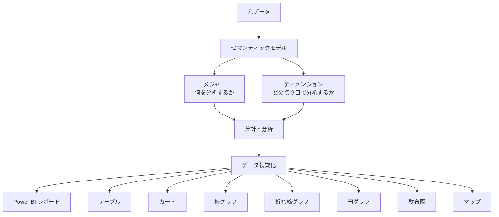

つまり、

> データを用意する  
> → データの意味や関係を定義する  
> → 何を・どの切り口で分析するか決める  
> → 集計する  
> → 分かりやすく視覚化する

という流れ。

---

# 2. セマンティックモデル

## セマンティックモデルとは

元データを分析できるように構造化し、

- 各データが何を意味しているのか
- データ同士がどのような関係なのか
- どの数値を分析するのか
- どのような切り口で分析するのか

などを定義した**分析用のデータモデル**。

「semantic」は「意味」という意味。

そのため、

> **セマンティックモデル = データを分析可能なように構造化し、それぞれのデータの意味やデータ同士の関係を明確にしたもの**

と考える。

例えば、次のような関係を定義する。

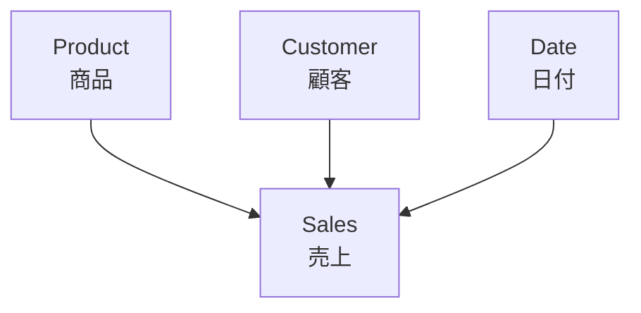

単にテーブルが存在するだけではなく、

```text
Sales    → 売上を表す
Product  → 商品を表す
Customer → 顧客を表す
Date     → 日付を表す

さらに、それぞれのテーブルが
どのように関連しているかを定義する。
```

---

# 3. メジャーとディメンション

## メジャー（Measure）

**分析対象となる数値。**

例：

- 売上金額
- 販売数量
- 利益

覚え方：

> **「何を分析するか？」= メジャー**

---

## ディメンション（Dimension）

**メジャーをどのような切り口で集計・分析するかを表すもの。**

例：

- 商品
- 顧客
- 地域
- 時間

例えば「商品別の売上金額」なら、

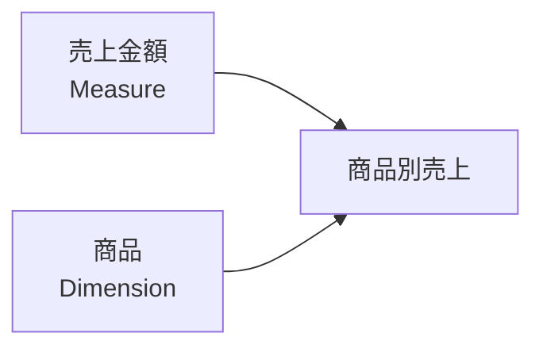

```text
売上金額
→ 分析対象
→ メジャー

商品
→ 分析の切り口
→ ディメンション
```

### 試験向けの覚え方

> **Measure = 何を？**

> **Dimension = 何別に？**

---

# 4. ファクトテーブルとディメンションテーブル

## ファクトテーブル

分析対象となるイベントや数値を保持するテーブル。

例：

```text
Sales

日付ID | 商品ID | 顧客ID | 数量 | 売上金額
-------|--------|--------|------|---------
001    | P001   | C001   | 2    | 100000
002    | P002   | C001   | 1    |  50000
003    | P001   | C002   | 3    | 150000
```

販売数量や売上金額など、分析対象となる数値を含む。

---

## ディメンションテーブル

分析するときの切り口となる情報を保持する。

例えば Product テーブルなら、

```text
商品ID | 商品名   | カテゴリ
-------|----------|----------
P001   | Surface  | PC
P002   | Xbox     | Game
```

覚え方：

```text
Fact
→ 「何が起きた？」

Dimension
→ 「何について分析する？」
```

---

# 5. スタースキーマ

ファクトテーブルを中心として、1つ以上のディメンションテーブルが関連する構造。

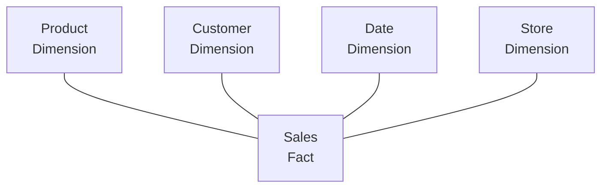

ここでは、

```text
Sales
→ Fact Table

Product
Customer
Date
Store
→ Dimension Table
```

中央のファクトテーブルを中心にディメンションが広がるため、

> **Star Schema**

と呼ばれる。

---

# 6. スノーフレークスキーマ

ディメンションテーブルが、さらに別の詳細テーブルと関連する構造。

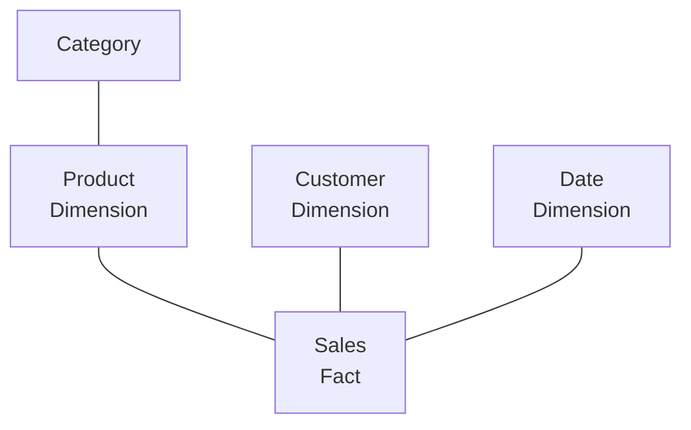

ここでは Product がさらに Category と関連している。

## Star と Snowflake の違い

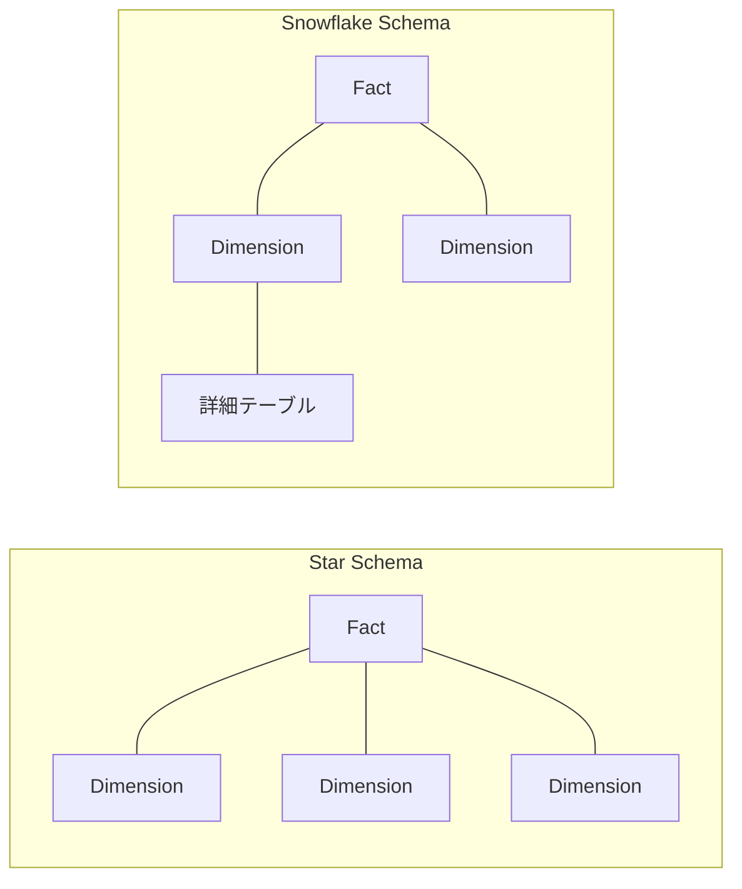

重要：

> **Snowflake = より細かく分析するという意味ではない。**

> **Dimension がさらに別の詳細テーブルと関連している構造。**

---

# 7. 階層（Hierarchy）

ディメンションには階層を定義できる。

例えば時間なら、

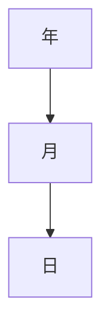

商品なら、

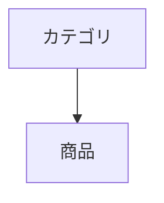

---

## ドリルダウン

大きな単位から小さな単位へ掘り下げる。

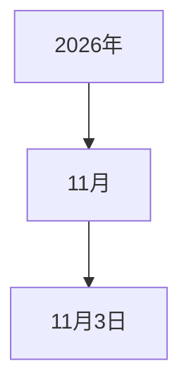

```text
年
↓
月
↓
日
```

---

## ドリルアップ

ドリルダウンの逆。

```text
日
↓
月
↓
年
```

詳細なレベルから大きな単位へ戻る。

### 覚え方

```text
Drill Down
大 → 小

Drill Up
小 → 大
```

---

# 8. VertiPaq

## VertiPaqとは

Power BI で Import モードを使用した場合、セマンティックモデルにインポートされたデータは VertiPaq によって、

> **インメモリの列指向ストア**

に格納される。

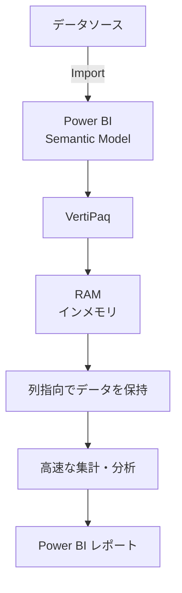

VertiPaq は、

```text
インメモリ
+
列指向
```

という2つに分けて理解すると分かりやすい。

---

# 9. インメモリ

データを RAM（メモリ）上で扱うこと。

```text
インメモリ
= どこでデータを扱うか
= RAM
```

メモリ上のデータを効率的に処理することで、高速な分析につながる。

---

# 10. 列指向

例えば次のデータがある。

```text
日付       商品       売上金額
11/01      Surface    100000
11/01      Xbox        50000
11/02      Surface    120000
```

行単位で見ると、

```text
11/01, Surface, 100000
11/01, Xbox,      50000
11/02, Surface, 120000
```

1行には、

- 日付
- 商品
- 金額

という異なる種類のデータが存在する。

列指向では、概念的には列単位で扱う。

```text
日付
11/01
11/01
11/02

商品
Surface
Xbox
Surface

売上金額
100000
50000
120000
```

例えば、

> 「売上金額の合計を求める」

なら、

```text
売上金額
100000
 50000
120000
   ↓
 SUM
   ↓
270000
```

のように売上金額の列を使って集計する。

そのため、

- 合計
- 平均
- 最大値
- 最小値

などの分析で、必要となる列を効率的に処理できる。

## 整理

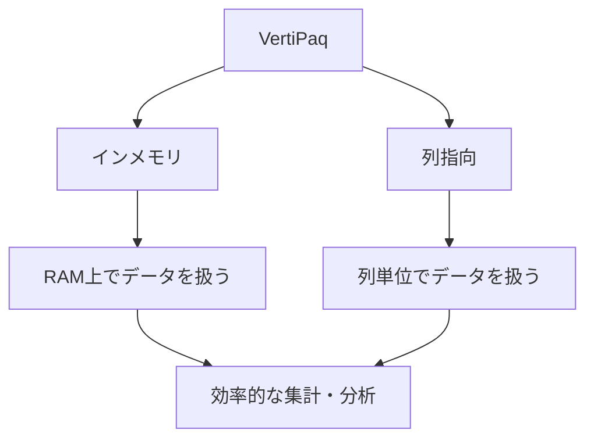

覚え方：

```text
インメモリ
= どこで扱う？
→ RAM

列指向
= どの単位で扱う？
→ 列
```

---

# 11. Direct Lake

Microsoft Fabric では、OneLake にデータが格納されている場合、Direct Lake を利用できる。

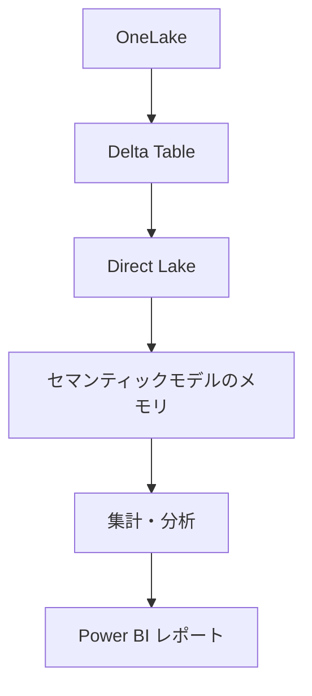

## Import モードとのイメージの違い

### Import

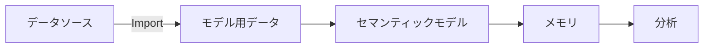

### Direct Lake

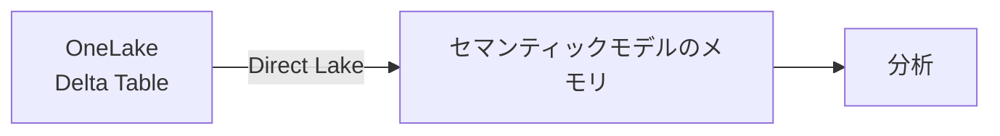

重要なのは、

> **「コピーしない」= メモリへ読み込まない**

ではないということ。

Direct Lake でも分析のためにデータをメモリへ読み込む。

ポイントは、

> **分析用としてモデルに別途データをコピーするのではなく、OneLake 上の Delta テーブルからセマンティックモデルのメモリへ直接読み込む**

こと。

### 名前から覚える

```text
Direct + Lake

= Lake にあるデータを直接利用する
```

---

# 12. データ視覚化

セマンティックモデルを作成した後、そのモデルを使用してデータを視覚化し、Power BI レポートを作成する。

重要なのは、

> **「何を伝えたいか」に応じて適切な視覚化を選択すること。**

---

# 13. テーブル

関連する多数の値を表示する場合に適している。

```text
商品       売上
-------------------
Surface    500万円
Xbox       300万円
Office     200万円
```

> **多数の正確な値を確認 → テーブル**

---

# 14. カード

重要な数値やメトリックを個別に表示する。

```text
┌──────────────┐
│    総売上     │
│              │
│   1,000万円   │
└──────────────┘
```

> **重要な1つの数値 → カード**

---

# 15. 横棒グラフ・縦棒グラフ

個別のカテゴリの数値を比較する。

```text
Surface  ██████████  500万円
Xbox     ██████      300万円
Office   ████        200万円
```

> **カテゴリ間の比較 → 棒グラフ**

---

# 16. 折れ線グラフ

特に、時間に伴う傾向を見る場合に適している。

```text
売上
 ↑
 │              ●
 │          ●
 │      ●
 │  ●
 └────────────────→ 月
   1月  2月  3月  4月
```

> **時系列・傾向 → 折れ線グラフ**

---

# 17. 円グラフ

全体に占める割合を比較する。

```text
総売上 = 100%

Surface → 50%
Xbox    → 30%
Office  → 20%
```

> **全体に対する割合 → 円グラフ**

---

# 18. 散布図

2つの数値的な大きさの関係・相関を確認する。

例えば、

```text
広告費
  と
売上金額
```

の関係。

```text
売上
 ↑
 │             ●
 │        ●
 │      ●   ●
 │   ●
 │ ●
 └────────────────→ 広告費
```

> **2つの数値の関係・相関 → 散布図**

---

# 19. マップ

地域・場所による値の違いを視覚化する。

例：

- 地域別売上
- 都市別顧客数

> **地理的な違い → マップ**

---

# 20. 視覚化の選び方

視覚化の使い分けを図にすると次のようになる。

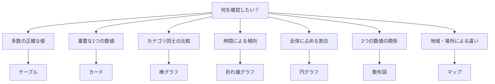

この対応は試験対策として重要。

---

# 21. Power BI の対話型レポート

Power BI のレポートでは、関連する複数のビジュアルが連動する。

例えば「福岡」を選択した場合、

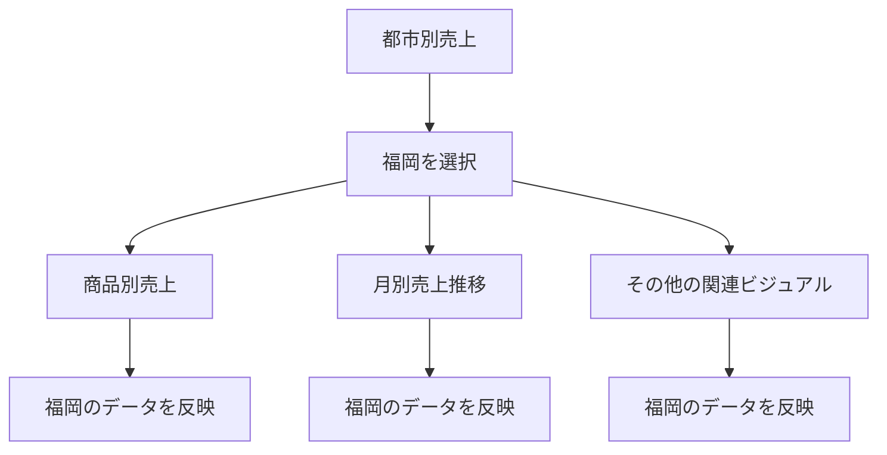

つまり、

> **1つのビジュアルを操作すると、関連する他のビジュアルも連動する。**

---

# 22. Power BI の AI を利用した視覚化

## スマートなストーリー

ビジュアルが示している内容について、文章による概要を自動生成する。

```text
データ
 ↓
グラフ
 ↓
AI
 ↓
文章による説明
```

---

## Copilot

レポートの内容について自然言語で質問したり、概要やビジュアルを取得したりできる。

```text
「このレポートをまとめて」
        ↓
     Copilot
        ↓
レポート内容について回答
```

---

## 主要なインフルエンサー

特定のメトリックへ強く影響している要因を識別する。

```text
「なぜ売上が高くなっている？」
              ↓
       影響要因を分析
```

> **「この結果に何が影響している？」を調べる機能**

---

## 分解ツリー

複数のディメンションにわたってドリルダウンし、値の原因を調べる。

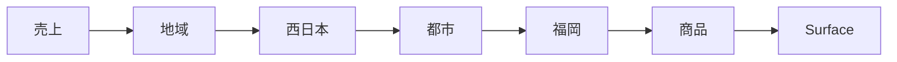

つまり、

> **複数の切り口で「どこが原因なのか？」を掘り下げる。**

---

# 23. DP-900 試験向け最重要ポイント

## 用語の対応

- **Measure**
  - 分析対象となる数値
  - 「何を分析する？」
  - 例：売上金額、販売数量

- **Dimension**
  - 分析するときの切り口
  - 「何別に分析する？」
  - 例：商品、顧客、時間

- **Fact Table**
  - 分析対象となるイベント・数値を保持する

- **Dimension Table**
  - 分析の切り口となる情報を保持する

- **Star Schema**
  - Fact を中心に Dimension が関連する

- **Snowflake Schema**
  - Dimension がさらに別の詳細テーブルと関連する

- **Hierarchy**
  - 年 → 月 → 日などの階層構造

- **Drill Down**
  - 大きい単位 → 小さい単位

- **Drill Up**
  - 小さい単位 → 大きい単位

- **Semantic Model**
  - データの意味・関係などを定義した分析用モデル

- **VertiPaq**
  - Import モードのセマンティックモデルのデータを効率的なインメモリ列指向ストアに格納する

- **Direct Lake**
  - OneLake の Delta テーブルからセマンティックモデルのメモリへ直接読み込み、分析する

---

# 24. 最終的な理解

今回登場した用語は、バラバラに暗記するのではなく、一連のデータ分析の流れとして理解する。

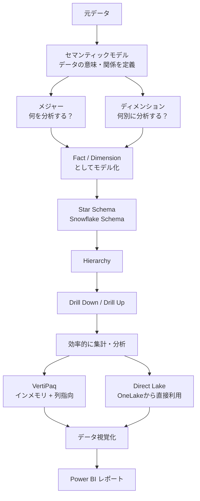

## 最後に一言で整理

```text
Semantic Model
→ データをどういう意味・関係で分析するか

Measure
→ 何を分析するか

Dimension
→ どの切り口で分析するか

Fact / Dimension Table
→ それらをどのようにテーブルとして構成するか

Star / Snowflake
→ テーブルをどのような関係で構成するか

Hierarchy
→ どの粒度で分析するか

VertiPaq
→ インポートされたデータを効率的に集計・分析する

Direct Lake
→ OneLake 上のデータを直接利用して分析する

Visualization
→ 分析結果をどのように見せるか
```

この「役割の違い」を理解しておけば、DP-900 の問題で似たような用語が並んでも、

**「これはデータの意味の話か？」
「分析対象の話か？」
「分析の切り口の話か？」
「保存・処理方式の話か？」
「視覚化の話か？」**

という観点から切り分けて判断できる。
